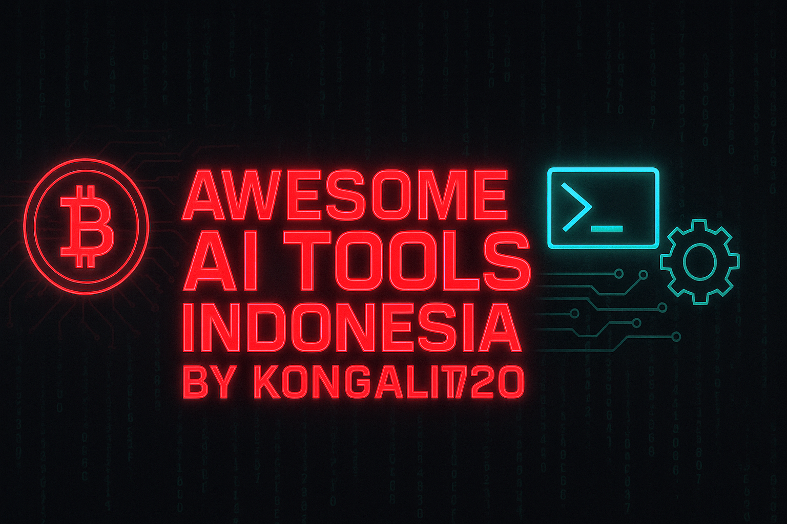

<h1 align="center"> 🇮🇩 Awesome AI Tools Indonesia</h1>

> 🚀 Kumpulan AI Tools terbaik untuk kamu yang mau belajar, kerja, atau produktif dengan bantuan AI — dikurasi khusus untuk pengguna di Indonesia.

  
  
  
  
  
  

Made with 💻 + ☕ by <b>Kongali1720</b>

  

## 📚 Kategori Tools
> Jelajahi tools berdasarkan kegunaannya:

- 🎨 [Desain & Gambar](#desain--gambar) → Bikin konten visual dengan bantuan AI
- 👨‍💻 [Coding & Pengembangan](#coding--pengembangan) → Auto-complete, debugging, IDE AI

- 🎨 [Desain & Gambar](#desain--gambar)
- 👨‍💻 [Coding & Pengembangan](#coding--pengembangan)
- 🎓 [Pendidikan & Belajar](#pendidikan--belajar)
- 💼 [Bisnis & Produktivitas](#bisnis--produktivitas)
- 🎙️ [Audio & Musik](#audio--musik)
- 🎥 [Video & Editing](#video--editing)

---

## 🎨 Desain & Gambar
| Nama | Fungsi | Link |
|------|--------|------|
| [Leonardo.AI](https://leonardo.ai) | Bikin gambar AI seperti Midjourney | ✅ Gratis |
| [Canva AI](https://www.canva.com/ai-image-generator/) | Generator desain dan gambar | ✅ Gratis |
| [Pixlr](https://pixlr.com) | Edit foto online pakai AI | ✅ Gratis |

---

## 👨‍💻 Coding & Pengembangan
| Nama | Fungsi | Link |
|------|--------|------|
| [Codeium](https://codeium.com) | Copilot gratis untuk VS Code & JetBrains | ✅ Gratis |
| [Tabnine](https://www.tabnine.com) | Auto-complete kode pakai AI | 🔄 Freemium |
| [Replit Ghostwriter](https://replit.com/ghostwriter) | AI helper di Replit IDE | 🔄 Berbayar |

---

## 🎓 Pendidikan & Belajar
| Nama | Fungsi | Link |
|------|--------|------|
| [ChatGPT](https://chat.openai.com) | Chatbot pintar buat tanya apa aja | ✅ Gratis (dengan login) |
| [Khan Academy](https://www.khanacademy.org/) | Belajar bareng AI tutor "Khanmigo" | ✅ Gratis |
| [Notion AI](https://www.notion.so/product/ai) | Bantu nulis & rangkum materi | 🔄 Berbayar |
| [HumanPen](https://humanpen.net) | Menulis ulang dokumen akademik, memformat sitasi, dan meringkas | 100 kredit saat daftar / kredit berbayar |

---

## 💼 Bisnis & Produktivitas
| Nama | Fungsi | Link |
|------|--------|------|
| [Jasper AI](https://www.jasper.ai) | Menulis konten marketing dengan AI | 🔄 Berbayar |
| [Copy.ai](https://www.copy.ai) | Buat caption, iklan, dan email otomatis | ✅ Gratis |
| [Durable.co](https://durable.co) | Bikin website otomatis pakai AI | ✅ Gratis |

---

## 🎙️ Audio & Musik
| Nama | Fungsi | Link |
|------|--------|------|
| [Voicemod](https://www.voicemod.net/) | Ubah suara real-time | ✅ Gratis |
| [Beatoven.ai](https://www.beatoven.ai/) | Musik bebas royalti dengan AI | ✅ Gratis |

---

## 🎥 Video & Editing
| Nama | Fungsi | Link |
|------|--------|------|
| [Runway ML](https://runwayml.com) | Edit video pakai AI, auto background remove | 🔄 Berbayar |
| [Pictory](https://pictory.ai/) | Ubah artikel jadi video | 🔄 Berbayar |
| [CapCut AI](https://www.capcut.com/tools) | Edit video & subtitle otomatis | ✅ Gratis |

---

## 🤝 Kontribusi

Mau nambah tools? Pull Request atau buka Issue aja!

1. Fork repo ini
2. Tambahkan tools di kategori yang sesuai
3. Kirim PR dengan format rapi  
📌 Contoh baris:

---

# Kasih ⭐ buat support proyek edukasi ini, bro.

---

# ✅ Gaspol coding squad Indonesia! 🚀💻

- Halo, Sobat Koding!

- Kumpulan mini project Python yang gak bikin ngantuk!

- Belajar sambil praktek langsung, cocok buat yang suka action daripada teori.

- Langsung eksekusi, langsung paham.

---

<h3 align="center">💡 ☕ Traktir Kopi & Nasi Padang ama nasi Gorengnya ya cuy! 😄</h3>

## Dukung terus biar semangat bikin karya edukatif lainnya...

# 💡 ☕  [Buy Me a Coffee via PayPal](https://www.paypal.com/paypalme/bungtempong99)  

Support with ☕ so I can buy 🍜 and keep being 🧠!

---

<h2>📫 Let’s Connect Like Hackers</h2>

| Platform | Detail |
|:--------|:-------|
| GitHub  | [kongali1720](https://github.com/kongali1720) |
| Email   | [kongali1720@gmail.com](mailto:kongali1720@gmail.com) |
| Site    | [Coming soon — stay curious... ](https://kongali1720.github.io)|

---

# ❤️  💻 INITIATING HUMANITY MODE... for Down Syndrome ❤️
| Item        | Keterangan |
|:------------|:-----------|
| 🎯 Target   | Anak-anak Pejuang Down Syndrome |
| 📡 Status   | Butuh Dukungan |
| 🧠 Response | Buka Hati + Klik Link = Satu Senyum Baru |

  Mereka bukan berbeda — mereka dilahirkan untuk mengajarkan dunia tentang cinta yang murni dan kesabaran yang luar biasa.

  

---

| Quotes | Penjelasan |
|:-------|:-----------|
| 🧡 "**Jadi hacker hati bukan cuma soal kode... tapi juga soal peduli.**" |  |
| 🧠 🎧"Ngoding boleh sambil senyum, asal jangan inject SQL sambil ngambek!" |  |

---

  <section id="dukungan-pembayaran">
    <h2>💳 Dukungan Pembayaran DONASINYA </h2>
    <table class="payment" aria-label="Metode Pembayaran">
      <thead>
        <tr>
          <th>Visa</th>
          <th>Mastercard</th>
          <th>PayPal</th>
        </tr>
      </thead>
      <tbody>
        <tr>
          <td></td>
          <td></td>
          <td></td>
        </tr>
      </tbody>
    </table>
  </section>

---

Kalau project ini bantu kamu, jangan lupa kasih bintang ⭐ dan share ke temen-temen ya!  
Follow @kongali1720 buat diskusi dan update seru lainnya 🔥

---
 <section id="coming-soon">
    <h2>🧪 Coming Soon</h2>
    <ul>
      <li>🔍 AI tools untuk cari kerja otomatis</li>
      <li>📊 Analisa data pake AI</li>
    </ul>
  </section>

  

    
  

  <footer>

